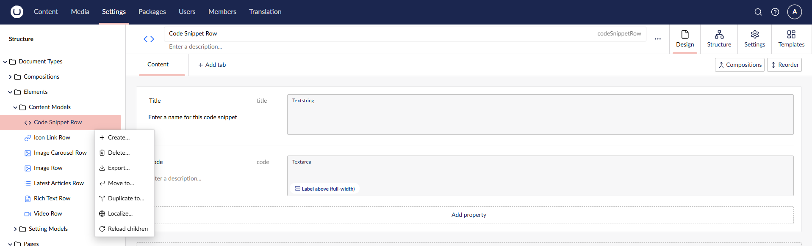
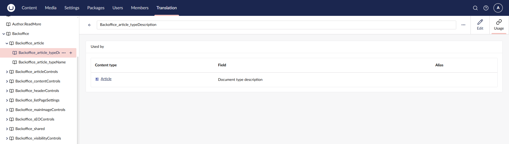

# Backoffice Auto Localizer

**Make the Umbraco backoffice truly multilingual.** Turn document type labels into dictionary items in a few clicks, so every editor sees them in their own language.

  ## Good to know

  - **Reload the backoffice after a change.** Translations load when the backoffice starts, so new or
  edited dictionary items show up after a browser refresh.
  - **Editors see their own language only if the site has it.** If an editor's backoffice language isn't
  one of the site's languages, they see the default language.

## Screenshots

**Auto Localizer lists every type and how many of its labels are translatable.**

**Pick the labels to make translatable.**

**The labels now point to dictionary items.**

**A dictionary item's Usage tab shows which types use it.**

## Acknowledgements

Thank you to [Jacob](https://github.com/iOvergaard) for his package [Lexicon](https://marketplace.umbraco.com/package/umbraco.community.lexicon), which inspired this one.
