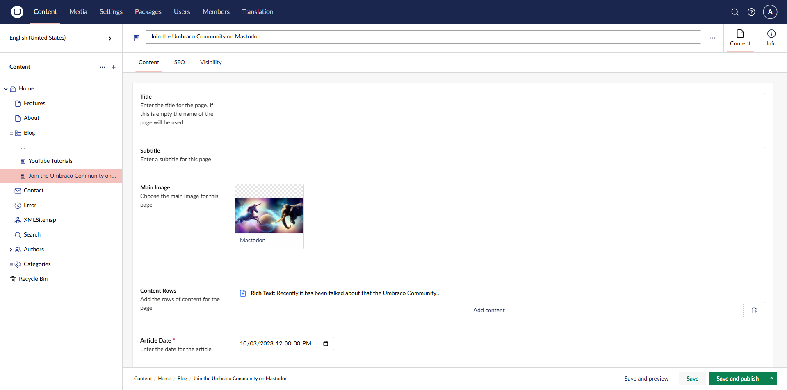
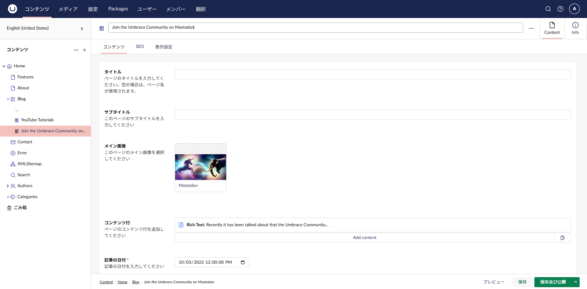
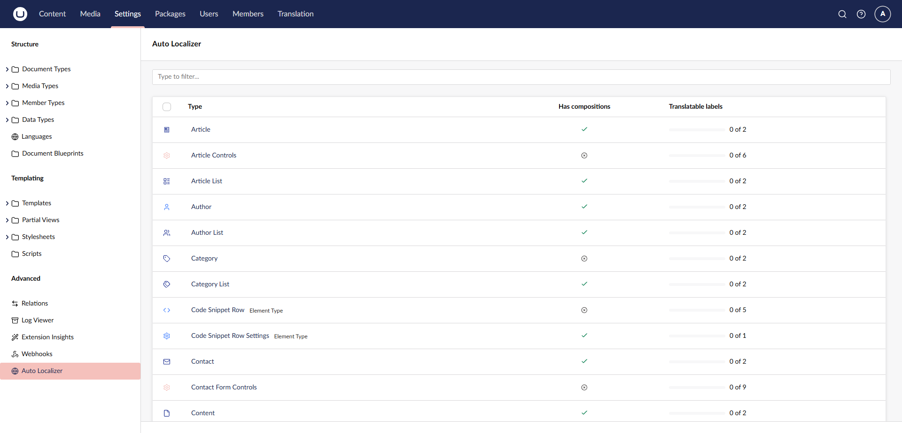
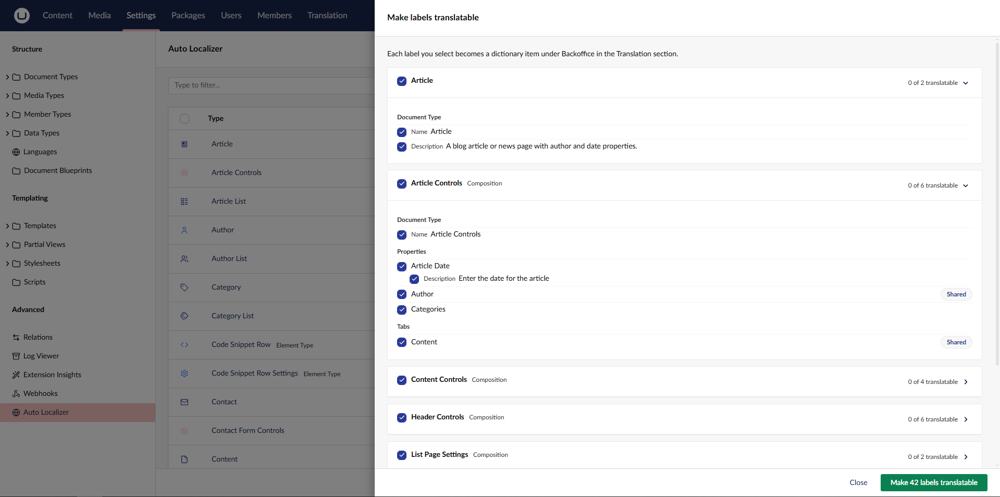
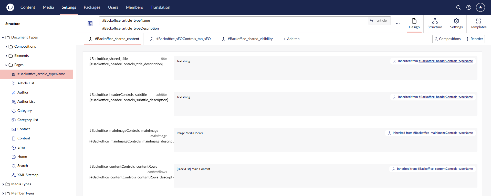

# Backoffice Auto Localizer


[](https://www.nuget.org/packages/backoffice-auto-localizer/)
[](https://marketplace.umbraco.com/package/backoffice-auto-localizer)

**Make the Umbraco backoffice truly multilingual.** Turn document type labels into dictionary items, so every editor sees them in their own language.

## How keys are named

Each label gets a key from its type alias and the alias of the property, tab or group it belongs to:

```
Backoffice_{typeAlias}_typeName
Backoffice_{typeAlias}_typeDescription
Backoffice_{typeAlias}_{propertyAlias}
Backoffice_{typeAlias}_{propertyAlias}_description
Backoffice_{typeAlias}_tab_{tabAlias}
Backoffice_{typeAlias}_group_{groupAlias}
```

New items go in a `Backoffice` folder, with a subfolder per type and one for shared items.

## Acknowledgements

Thank you to [Jacob](https://github.com/iOvergaard) for his package [Lexicon](https://marketplace.umbraco.com/package/umbraco.community.lexicon), which inspired this one.

## Screenshots

**The same page for an editor with an English backoffice, and one with a Japanese backoffice.**





**Settings ▸ Advanced ▸ Auto Localizer lists every type and how many of its labels are translatable.**



**Pick the labels to make translatable.**



**The labels now point to dictionary items.**



**A dictionary item's Usage tab shows which types use it.**

